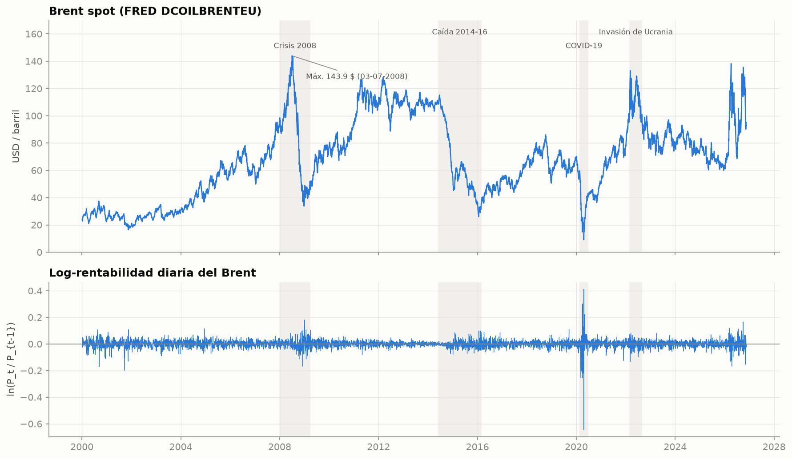
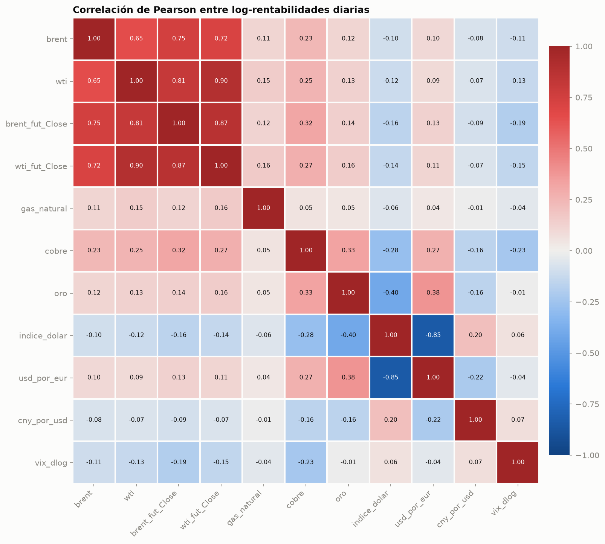

# Análisis exploratorio (Fase 1)

- Calendario: días con dato real del Brent en FRED, 2000-01-04 a 2026-11-17 (6511 filas, 20 columnas).
- Relleno: solo hacia delante, nunca hacia atrás. WTI <= 0 marcado como faltante antes de rellenar.

## Estacionariedad (ADF: H0 raíz unitaria; KPSS: H0 estacionaria)

| serie | especificacion | n | ADF_estadistico | ADF_p | KPSS_estadistico | KPSS_p | ADF_conclusion_5% | KPSS_conclusion_5% |
|---|---|---|---|---|---|---|---|---|
| ln(precio Brent) | constante | 6511 | -2.8851 | 0.0471 | 3.2713 | 0.0100 | estacionaria | no estacionaria |
| ln(precio Brent) | constante + tendencia | 6511 | -3.0872 | 0.1093 | 1.3415 | 0.0100 | raíz unitaria | no estacionaria |
| log-rentabilidad Brent | constante | 6510 | -14.0790 | 0.0000 | 0.0592 | 0.1000 | estacionaria | estacionaria |

El p-valor de KPSS está acotado por statsmodels a [0,01; 0,10].

## Faltantes por columna (sobre el calendario del Brent)

| columna | primer_dato | ultimo_dato_real | %_faltante_antes | %_faltante_antes_desde_primer_dato | %_faltante_despues | dias_rellenados | racha_max_faltantes_antes |
|---|---|---|---|---|---|---|---|
| brent | 2000-01-04 | 2026-11-17 | 0.00 | 0.00 | 0.00 | 0 | 0 |
| wti | 2000-01-04 | 2026-11-17 | 6.79 | 6.79 | 0.00 | 442 | 7 |
| tipo_bce | 2000-01-04 | 2026-11-17 | 0.00 | 0.00 | 0.00 | 0 | 0 |
| usd_por_eur | 2000-01-04 | 2026-11-13 | 2.52 | 2.52 | 0.00 | 164 | 2 |
| cny_por_usd | 2000-01-04 | 2026-11-13 | 2.50 | 2.50 | 0.00 | 163 | 2 |
| vix | 2000-01-04 | 2026-11-17 | 1.31 | 1.31 | 0.00 | 85 | 2 |
| brent_fut_Open | 2007-07-30 | 2026-11-17 | 26.91 | 2.52 | 25.02 | 123 | 12 |
| brent_fut_High | 2007-07-30 | 2026-11-17 | 26.91 | 2.52 | 25.02 | 123 | 12 |
| brent_fut_Low | 2007-07-30 | 2026-11-17 | 26.91 | 2.52 | 25.02 | 123 | 12 |
| brent_fut_Close | 2007-07-30 | 2026-11-17 | 26.91 | 2.52 | 25.02 | 123 | 12 |
| brent_fut_Volume | 2007-07-30 | 2026-11-17 | 26.91 | 2.52 | 25.02 | 123 | 12 |
| wti_fut_Open | 2000-08-23 | 2026-11-17 | 3.90 | 1.90 | 2.04 | 121 | 2 |
| wti_fut_High | 2000-08-23 | 2026-11-17 | 3.89 | 1.88 | 2.04 | 120 | 2 |
| wti_fut_Low | 2000-08-23 | 2026-11-17 | 3.92 | 1.91 | 2.04 | 122 | 2 |
| wti_fut_Close | 2000-08-23 | 2026-11-17 | 3.90 | 1.90 | 2.04 | 121 | 2 |
| wti_fut_Volume | 2000-08-23 | 2026-11-17 | 3.89 | 1.88 | 2.04 | 120 | 2 |
| gas_natural | 2000-08-30 | 2026-11-17 | 3.92 | 1.85 | 2.10 | 118 | 2 |
| cobre | 2000-08-30 | 2026-11-17 | 3.96 | 1.90 | 2.10 | 121 | 2 |
| oro | 2000-08-30 | 2026-11-17 | 3.98 | 1.91 | 2.10 | 122 | 2 |
| indice_dolar | 2000-01-04 | 2026-11-17 | 1.41 | 1.41 | 0.00 | 92 | 2 |

## Estadísticos de las log-rentabilidades diarias

| index | count | mean | std | min | max | asimetria | curtosis_exceso | fecha_min | fecha_max |
|---|---|---|---|---|---|---|---|---|---|
| brent | 6510.0000 | 0.0002 | 0.0275 | -0.6437 | 0.4120 | -1.7335 | 63.0992 | 2020-04-21 | 2020-04-22 |
| wti | 6510.0000 | 0.0002 | 0.0294 | -0.7203 | 0.4258 | -1.9900 | 76.0474 | 2020-04-21 | 2020-04-22 |
| brent_fut_Close | 4881.0000 | 0.0000 | 0.0241 | -0.2798 | 0.1908 | -0.8115 | 12.1021 | 2020-04-21 | 2020-04-02 |
| wti_fut_Close | 6377.0000 | 0.0002 | 0.0275 | -0.6017 | 0.3196 | -1.7293 | 48.5019 | 2020-04-21 | 2020-04-22 |
| gas_natural | 6373.0000 | -0.0001 | 0.0389 | -0.6440 | 0.3817 | -0.2688 | 18.5385 | 2026-01-29 | 2022-01-27 |
| cobre | 6373.0000 | 0.0003 | 0.0174 | -0.2517 | 0.1244 | -0.6080 | 10.8223 | 2025-07-31 | 2025-07-08 |
| oro | 6373.0000 | 0.0004 | 0.0115 | -0.1141 | 0.0864 | -0.4028 | 6.1856 | 2026-01-30 | 2008-09-17 |
| indice_dolar | 6510.0000 | 0.0000 | 0.0049 | -0.0272 | 0.0338 | -0.0369 | 2.1586 | 2009-03-18 | 2001-03-16 |
| usd_por_eur | 6510.0000 | 0.0000 | 0.0058 | -0.0387 | 0.0462 | 0.1275 | 3.1070 | 2001-03-16 | 2009-03-19 |
| cny_por_usd | 6510.0000 | -0.0000 | 0.0018 | -0.0202 | 0.0182 | -0.0747 | 14.5558 | 2005-07-22 | 2015-08-11 |
| vix_dlog | 6510.0000 | -0.0000 | 0.0732 | -0.4424 | 0.7682 | 1.0333 | 6.8024 | 2025-04-09 | 2018-02-05 |

## Estadísticos de las series en niveles

| index | count | mean | std | min | max | asimetria | curtosis_exceso | fecha_min | fecha_max |
|---|---|---|---|---|---|---|---|---|---|
| brent | 6511.00 | 69.23 | 28.02 | 9.12 | 143.95 | 0.17 | -0.80 | 2020-04-21 | 2008-07-03 |
| wti | 6511.00 | 65.77 | 24.56 | 8.91 | 145.31 | 0.16 | -0.63 | 2020-04-21 | 2008-07-03 |
| brent_fut_Close | 4882.00 | 78.62 | 23.66 | 19.33 | 146.08 | 0.16 | -0.79 | 2020-04-21 | 2008-07-03 |
| wti_fut_Close | 6378.00 | 66.42 | 24.09 | 10.01 | 145.29 | 0.15 | -0.56 | 2020-04-21 | 2008-07-03 |
| gas_natural | 6374.00 | 4.32 | 2.18 | 1.48 | 15.38 | 1.63 | 3.16 | 2020-06-25 | 2005-12-13 |
| cobre | 6374.00 | 3.03 | 1.27 | 0.60 | 6.80 | 0.08 | 0.14 | 2001-11-07 | 2026-09-09 |
| oro | 6374.00 | 1399.96 | 925.51 | 255.10 | 5318.40 | 1.64 | 3.46 | 2001-02-15 | 2026-01-29 |
| indice_dolar | 6511.00 | 92.71 | 10.94 | 71.33 | 120.90 | 0.19 | -0.66 | 2008-04-22 | 2001-07-05 |
| usd_por_eur | 6511.00 | 1.19 | 0.15 | 0.83 | 1.60 | 0.10 | -0.15 | 2000-10-25 | 2008-04-22 |
| cny_por_usd | 6511.00 | 7.08 | 0.71 | 6.04 | 8.28 | 0.60 | -0.94 | 2014-01-14 | 2002-01-14 |
| vix | 6511.00 | 19.65 | 8.27 | 9.14 | 82.69 | 2.34 | 8.98 | 2017-11-03 | 2020-03-16 |
| tipo_bce | 6511.00 | 1.03 | 1.44 | -0.50 | 4.00 | 0.59 | -1.04 | 2019-09-18 | 2023-09-20 |

## 15 días con |log-rentabilidad| del Brent más extrema

| fecha | precio_anterior | precio | log_rentabilidad | variacion_% |
|---|---|---|---|---|
| 2020-04-21 | 17.3600 | 9.1200 | -0.6437 | -47.4654 |
| 2020-04-22 | 9.1200 | 13.7700 | 0.4120 | 50.9868 |
| 2020-04-02 | 14.9700 | 20.2400 | 0.3016 | 35.2037 |
| 2020-03-31 | 19.1900 | 14.8500 | -0.2564 | -22.6159 |
| 2020-03-09 | 45.6000 | 35.3300 | -0.2552 | -22.5219 |
| 2020-05-05 | 20.4000 | 25.4600 | 0.2216 | 24.8039 |
| 2020-04-09 | 25.2200 | 20.2300 | -0.2205 | -19.7859 |
| 2020-03-18 | 27.9700 | 22.7900 | -0.2048 | -18.5198 |
| 2001-09-24 | 25.1700 | 20.6300 | -0.1989 | -18.0373 |
| 2020-04-03 | 20.2400 | 24.3300 | 0.1840 | 20.2075 |
| 2009-01-02 | 35.8200 | 42.9400 | 0.1813 | 19.8772 |
| 2000-09-13 | 36.8700 | 31.0800 | -0.1708 | -15.7038 |
| 2008-12-05 | 43.8300 | 37.0400 | -0.1683 | -15.4917 |
| 2026-04-17 | 116.6300 | 98.6300 | -0.1676 | -15.4334 |
| 2026-10-02 | 114.8200 | 135.5100 | 0.1657 | 18.0195 |

## Correlaciones entre log-rentabilidades

| index | brent | wti | brent_fut_Close | wti_fut_Close | gas_natural | cobre | oro | indice_dolar | usd_por_eur | cny_por_usd | vix_dlog |
|---|---|---|---|---|---|---|---|---|---|---|---|
| brent | 1.00 | 0.65 | 0.75 | 0.72 | 0.11 | 0.23 | 0.12 | -0.10 | 0.10 | -0.08 | -0.11 |
| wti | 0.65 | 1.00 | 0.81 | 0.90 | 0.15 | 0.25 | 0.13 | -0.12 | 0.09 | -0.07 | -0.13 |
| brent_fut_Close | 0.75 | 0.81 | 1.00 | 0.87 | 0.12 | 0.32 | 0.14 | -0.16 | 0.13 | -0.09 | -0.19 |
| wti_fut_Close | 0.72 | 0.90 | 0.87 | 1.00 | 0.16 | 0.27 | 0.16 | -0.14 | 0.11 | -0.07 | -0.15 |
| gas_natural | 0.11 | 0.15 | 0.12 | 0.16 | 1.00 | 0.05 | 0.05 | -0.06 | 0.04 | -0.01 | -0.04 |
| cobre | 0.23 | 0.25 | 0.32 | 0.27 | 0.05 | 1.00 | 0.33 | -0.28 | 0.27 | -0.16 | -0.23 |
| oro | 0.12 | 0.13 | 0.14 | 0.16 | 0.05 | 0.33 | 1.00 | -0.40 | 0.38 | -0.16 | -0.01 |
| indice_dolar | -0.10 | -0.12 | -0.16 | -0.14 | -0.06 | -0.28 | -0.40 | 1.00 | -0.85 | 0.20 | 0.06 |
| usd_por_eur | 0.10 | 0.09 | 0.13 | 0.11 | 0.04 | 0.27 | 0.38 | -0.85 | 1.00 | -0.22 | -0.04 |
| cny_por_usd | -0.08 | -0.07 | -0.09 | -0.07 | -0.01 | -0.16 | -0.16 | 0.20 | -0.22 | 1.00 | 0.07 |
| vix_dlog | -0.11 | -0.13 | -0.19 | -0.15 | -0.04 | -0.23 | -0.01 | 0.06 | -0.04 | 0.07 | 1.00 |
